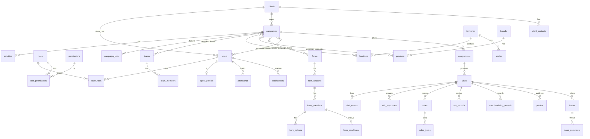

# Data model

PostgreSQL, UUID primary keys, soft deletes on clients, campaigns, locations, products and forms (never on audit, visit events or submitted visits). Enums are `varchar` + CHECK. Migrations: `database/migrations/2026_01_01_00000{1..4}_*.php`.

## Tables (59)
- **Identity**: users, password_reset_tokens, personal_access_tokens, roles, permissions, role_permissions, user_roles, security_events, audit_logs, agent_profiles
- **Clients**: clients, client_contacts, client_documents
- **Planning**: campaigns, activities, campaign_users, campaign_forms, campaign_kpis, campaign_teams, campaign_locations, campaign_products, teams, team_members, territories, locations, routes, route_locations, brands, product_categories, products
- **Forms**: forms, form_sections, form_questions, form_options, form_conditions
- **Execution**: assignments, attendance, visits, visit_checkins, visit_checkouts, visit_events, visit_responses, sales, sales_items, osa_records, merchandising_records, photos, issues, issue_comments
- **Platform**: notifications, report_exports, agency_settings, gps_rules, idempotency_keys, jobs, failed_jobs, cache, cache_locks

## Notes
- Offline-created entities carry `client_uuid` with `UNIQUE(created_by, client_uuid)`.
- `visit_checkins` and `visit_checkouts` store GPS evidence: coordinates, accuracy, device and server timestamps, distance, outcome and reasons.
- CHECK constraints guard radius > 0, lat/lng ranges, quantities ≥ 0 and `end_date ≥ start_date`.
- `photos` keeps the SHA-256 for reuse detection and a review status.
